# Norns

A personal tracking system for a two-person household. It watches what arrives
on its own (**bank transactions** and **email**) and shows it on one
phone-friendly app: where the money went, what is worth converting and what the
household is worth, which card credits are about to lapse, which class action
settlements are worth filing, what the wedding still costs, and what still
needs a human.

> **This repository is a feature mirror.** The live system runs privately on
> real accounts. This copy carries the same app, sweeps, schema and database
> functions. Every name, key, project id and row of personal data has been
> taken out, and the app runs on an invented household (Alex and Sam) that is
> built in the browser. **[Open the demo](https://aj-protzel.github.io/tracking-engine-showcase/)**,
> or open `page/index.html` locally. Every card works: taps, renames,
> dismissals and edit mode behave as they do live, and a reload starts over.

## The rule it is built on

> **Schedule only what arrives whether or not you ask.**

Bank transactions and mail arrive on their own, so each gets one scheduled job.
Merchant names, owned items and wedding costs only happen because a person
starts them, so a Claude skill handles each of those in a chat when asked. That
rule took the system from a three-phase pipeline, with a model rebuilding the
page every morning, down to three small jobs. One uses no model at all, and one
uses a small model only for senders it has never seen.

```mermaid
flowchart LR
  bank[Bank accounts] -->|SimpleFIN, every 4h| fn[Edge function<br/>simplefin-sweep.ts]
  gmail[Gmail] -->|every 5 min| gs[Apps Script<br/>mail-watch.js]
  gs --> mw[Edge function<br/>mail-watch.ts + mail-sort.ts]
  mw -->|unknown senders| haiku[Claude Haiku]
  mw -->|Web Push| phone[Phone]
  gmail -->|daily| routine[Claude routine<br/>email-sweep.md]
  fn --> db[(Supabase Postgres)]
  mw --> db
  routine --> db
  chat[Claude chat skills<br/>accountant · secretary · wedding] <--> db
  db -->|page_data&#40;&#41;| page[Static app<br/>page/]
```



## What the app shows

Pages and cards are the defaults; in edit mode (long press) cards can be
dragged, stacked, moved between pages or added from a gallery, and the layout
is saved per user.

| Page | Cards |
|---|---|
| **Alerts** | **Requires Action**: what the sweeps raised (drafts to check, failed bills, invites, urgent mail), sweeps that failed or went quiet, card credits about to lapse, and charges with no category, each fileable in one tap. **Highlights**: one-line notes from the mail watch. **To Do** with a Backlog. **Settlements** the household likely qualifies for. **Job Tracking** counted from job mail. |
| **Balance** | **Spending**: a four-week heat map of daily spending against a day budget. **Money**: a month navigator with in, out and net, spend by category, and a ledger where a charge or a whole merchant can be renamed, recategorized or marked as a wedding cost. **Credits**: every card statement credit with its cycle, deadline and how much has been used. |
| **Wallet** | **Exchange**: whether today is a good day to convert between two currencies, against the recent window of rates. **Net Worth**: every account, owned against owed, with its trend over time. |
| **Wedding** | The couple's shared crew sheet in a frame (the separate [wedding-tracker](https://github.com/AJ-Protzel/wedding-tracker) demo), plus two private tabs: **Costs** (paid, due, promised and received, from the bank feed and an off-bank ledger) and **Shopping** (the store run, ticked off item by item). |

Live, the app installs to a phone's home screen and badges its icon with the
Requires Action count.

## The hookups

Each connection is in the code, readable end to end. Here each one points at a
placeholder instead of a real account.

| Source | How it connects | File |
|---|---|---|
| **SimpleFIN** (bank feed) | A Supabase edge function on `pg_cron` every four hours. It works in windows set by a watermark, carries pending charges until they settle or are pruned, and records balances for the net-worth trend. No model, no tokens. | `sweeps/simplefin-sweep.ts` |
| **Gmail, every five minutes** | An Apps Script in the inbox runs plain rules (`classify()`) for urgent mail and hands new mail to an edge function. That function files each message by rules first and asks Claude Haiku only about unknown senders, under a monthly cap, then sends Web Push to the phone. Quiet hours hold pushes until morning. | `sweeps/mail-watch.js`, `mail-watch.ts`, `mail-sort.ts`, `webpush.ts` |
| **Gmail, daily** | One Claude routine drafts replies, records orders and job events, and raises Requires Action rows. All its judgment comes from the secretary skill, so a scheduled run and a chat cannot disagree. | `sweeps/email-sweep.md` |
| **Class action sites + notices** | Folded into the same routine. Notices get a row every run, and a search of settlement listing sites runs on Sundays. A row is only written when there is evidence the household qualifies, matched against a list of what it owns. | `sweeps/settlement-sweep.md` |
| **Supabase** | Postgres with row-level security, no table granted to the browser, and `security definer` functions as the app's only door. | `database/` |
| **The app** | A static site. Live, it signs in and calls `page_data()`. Here, `page/demo-data.js` answers every call with an invented household. | `page/` |

## Design decisions worth reading

- **Token cost is a design constraint.** The app queries the database each time
  it opens, instead of a model re-rendering it every morning. The mail watch
  decides by rules and only pays for a model on senders the rules do not know.
- **A model reads; code decides.** Where a model is asked anything, it is asked
  to read and label, and code turns that into the action.
- **One owner per fact.** A table's prefix names the skill that owns it
  (`accountant_*`, `secretary_*`, `wedding_*`). Allowed values live in one
  document, `database/SCHEMA.md`, after two bugs in one day came from a value
  list kept in two places.
- **Failures surface where they are read.** A sweep that fails, loads nothing or
  goes quiet raises itself on the Alerts page, and a failed run is never counted
  as a sync.
- **The page holds no copy of an enum.** Statuses come from `enum_range()` in
  `page_data()`, so renaming a value in the database drops a button rather than
  sending a value the database would reject.
- **Dates are Pacific; the database is UTC.** Every wrong date in the project
  came from something reading a UTC clock as "today", so every query spells out
  the time zone.
- **Push is tested without a phone.** `sweeps/mail-watch.test.mjs` checks the
  Web Push encryption byte for byte against RFC 8291's example and runs the
  urgent-mail rules on sample mail: `node sweeps/mail-watch.test.mjs`.

## What is in here

| Path | What it is |
|---|---|
| `page/` | The app: `index.html` (one template per card), `data.js` (the row store and the one call), `layout.js` and `edit.js` (pages, cards and edit mode), then one script and stylesheet per page. `demo-data.js` is the invented household. |
| `sweeps/` | The scheduled jobs, their tests, and the instructions the daily routine follows. |
| `database/SCHEMA.md` | Every table, every constrained column and its legal values, and the rules the columns imply but cannot enforce. |
| `database/functions.sql` | Every Postgres function, generated from the live database with `pg_get_functiondef` rather than written by hand. |

## Running it

Open `page/index.html` in a browser, or serve the folder:

```bash
python -m http.server 8765 --directory page
```

## Stack

Supabase (Postgres, edge functions, `pg_cron`, Vault) · SimpleFIN · Google Apps
Script · Web Push · Claude routines, Claude Haiku and skills with Gmail, Google
Calendar and Supabase connectors · plain HTML, CSS and JavaScript, no build step.

## History

The page began as a Claude artifact reading the database through the viewer's
own connector, then moved to a static site with its own sign-in. A rental
listing sweep (RentCast, Apify and Gemini) ran until the household found a
place and was retired; it is in this repository's history.

## License

MIT. See `LICENSE`.
