# Tracking Engine

A personal tracking system for a two-person household. It watches what arrives
on its own (**bank transactions**, **email**, **rental listings**) and shows
it on one phone-friendly page: where the money went, what was eaten, which card
credits are about to lapse, which class action settlements are worth filing,
and what still needs a human.

> **This repository is a feature mirror.** The live system runs privately on
> real accounts. This copy carries the same page, sweeps, schema and database
> functions. Every name, key, project id and row of personal data has been
> taken out, and the page runs on an invented household that is built in the
> browser. **[Open the demo](https://aj-protzel.github.io/tracking-engine-showcase/)**, or open
> `page/index.html` locally. Every card works: taps, renames and
> dismissals behave as they do live, and a reload starts over.

## The rule it is built on

> **Schedule only what arrives whether or not you ask.**

Bank transactions, mail and new listings arrive on their own, so each gets one
scheduled job. Meals, symptoms and merchant names only happen because a person
starts them, so a Claude skill handles each of those in a chat when asked. That
rule took the system from a three-phase pipeline, with a model rebuilding the
page every morning, down to a few small jobs. Two of them use no model at all.

```mermaid
flowchart LR
  bank[Bank accounts] -->|SimpleFIN, every 4h| fn[Edge function<br/>simplefin-sweep.ts]
  gmail[Gmail + Calendar] -->|nightly| routine[Claude routine<br/>email-sweep.md]
  feed[RentCast + Zillow via Apify] -->|daily| rent[Edge function<br/>rental-sweep.ts]
  rent -->|reads each listing| gem[Gemini]
  fn --> db[(Supabase Postgres)]
  routine --> db
  rent --> db
  chat[Claude chat skills<br/>doctor · accountant · secretary] <--> db
  db -->|page_data&#40;&#41;| page[Static page<br/>page/]
```



## What the page shows

| Tab | Cards |
|---|---|
| **Alerts** | **Requires Action**: what the nightly sweep raised (drafts to check, failed bills, invites, events it added), sweeps that failed or went quiet, card credits about to lapse, and charges with no category, each fileable in one tap. **To Do** with a Backlog. **Settlements** the household likely qualifies for. **Job Tracking** counted from job mail. |
| **Food** | **Intake**: fourteen days of calories per person, each bar split into protein, carbs and fat, with a dashed line at that person's own average. **Doctor's Recommendation**, written by the doctor skill on request. |
| **Balance** | **Spending**: a four-week heat map of dining, grocery and shopping against weekly benchmark caps. **Money**: a month navigator with in, out and net, spend by category, and a ledger where a charge or a whole merchant can be renamed. **Credits**: every card statement credit with its cycle, deadline and how much has been used. |
| **Rentals** | Houses that passed an automated vetting, grouped one row per building, ordered by how likely an application is to be accepted, with status tracking and a "Not for us" that records why. |

## The hookups

Each connection is in the code, readable end to end. Here each one points at a
placeholder instead of a real account.

| Source | How it connects | File |
|---|---|---|
| **SimpleFIN** (bank feed) | A Supabase edge function on `pg_cron` every four hours. It works in windows set by a watermark, and carries pending charges until they settle or are pruned. No model, no tokens. | `sweeps/simplefin-sweep.ts` |
| **Gmail + Google Calendar** | One nightly Claude routine files the inbox, drafts replies, creates events that name a date and a time, and raises Requires Action rows. All its judgment comes from the secretary skill, so a 1am run and a 2pm chat cannot disagree. | `sweeps/email-sweep.md` |
| **Class action sites + notices** | Folded into the same routine. Notices get a row every night, and a search of four settlement listing sites runs on Sundays. A row is only written when there is evidence the household qualifies. | `sweeps/settlement-sweep.md` |
| **RentCast, Apify, Gemini** | A daily listing pull capped at the plan's request quota. An Apify Zillow scraper fetches each house's details. Gemini only *reads* the listing and answers four questions, and `decide()` in code turns those answers into pass, unsure or fail. | `sweeps/rental-sweep.ts` |
| **Supabase** | Postgres with row-level security, no table granted to the browser, and six `security definer` functions as the page's only door. | `database/` |
| **The page** | A static site. Live, it signs in and makes one call, `page_data()`. Here, `page/demo-data.js` answers that call with an invented household. | `page/` |

## Design decisions worth reading

- **Token cost is a design constraint.** The page queries the database each time
  it opens, instead of a model re-rendering it every morning at tens of thousands
  of output tokens a day.
- **A model reads; code decides.** Asked for a verdict directly, the model passed
  houses its own summary said had no AC. Asked only to read, it is reliable, so
  the verdict lives in code.
- **One owner per fact.** A table's prefix names the skill that owns it
  (`doctor_*`, `accountant_*`, `secretary_*`). Allowed values live in one
  document, `database/SCHEMA.md`, after two bugs in one day came from a value
  list kept in two places.
- **Failures surface where they are read.** A sweep that fails, loads nothing or
  goes quiet raises itself on the Alerts tab, and a failed run is never counted
  as a sync.
- **The page holds no copy of an enum.** Statuses come from `enum_range()` in
  `page_data()`, so renaming a value in the database drops a button rather than
  sending a value the database would reject.
- **Dates are Pacific; the database is UTC.** Every wrong date in the project
  came from something reading a UTC clock as "today", so every query spells out
  the time zone.
- **Free tiers are budgets.** Each paid API is capped by the run itself: the
  listing pull counts its requests against the plan's quota, and a building's
  units share one scraper read.

## What is in here

| Path | What it is |
|---|---|
| `page/` | The site: `index.html`, one script and stylesheet per tab, and `data.js`, which owns page switching and the one call. `demo-data.js` is the invented household. |
| `sweeps/` | The three scheduled jobs and the settlement instructions the nightly routine follows. |
| `database/SCHEMA.md` | Every table, every constrained column and its legal values, and the rules the columns imply but cannot enforce. |
| `database/functions.sql` | Every Postgres function, generated from the live database with `pg_get_functiondef` rather than written by hand. |

## Running it

Open `page/index.html` in a browser, or serve the folder:

```bash
python -m http.server 8765 --directory page
```

## Stack

Supabase (Postgres, edge functions, `pg_cron`, Vault) · SimpleFIN · RentCast ·
Apify · Gemini · Claude routines and skills with Gmail, Google Calendar and
Supabase connectors · plain HTML, CSS and JavaScript, no build step.

## History

The page began as a Claude artifact reading the database through the viewer's
own connector. That works for one viewer only, so the system moved to a static
site with its own sign-in. The artifact-era snapshot is in this repository's
history.

## License

MIT. See `LICENSE`.
