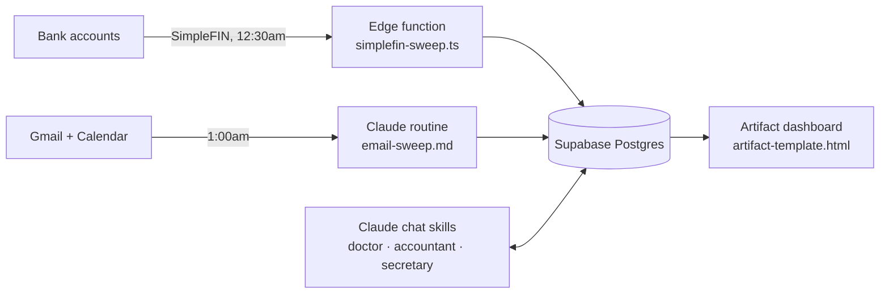

# Tracking Engine — artifact edition

> **Archived snapshot (2026-09-14).** This is a personal tracking system as it
> stood while its dashboard was a Claude artifact. The live system has since
> moved to a private repository and a signed-in static site, and this copy is
> not updated. Personal data, account details and project identifiers have been
> removed; the page ships with no data in it.

A one-person tracking system that watches the two things that arrive on their
own — **bank transactions** and **email** — and shows what it finds on a single
phone-friendly page: where the money went, what was eaten, and what still needs
a human. Everything else is added by talking to a Claude skill in a chat, not by
anything running on a timer.

## The rule it is built on

> **Schedule only what arrives whether or not you ask.**

Transactions arrive from the bank and mail arrives in the inbox, so each gets one
scheduled job. Meals, symptoms and merchant names only ever happen because a
person starts them, so they are handled on demand by the skill that owns that
data. That rule took the system from a three-phase pipeline, with a model
rebuilding the page every morning, down to two jobs — one of which uses no model
at all.

## What is in here

| Path | What it is |
|---|---|
| `sweeps/simplefin-sweep.ts` | Supabase edge function that loads transactions from SimpleFIN nightly. Watermark-driven windows, pending charges carried and pruned, a resumable 90-day backfill. No model, no tokens. |
| `sweeps/email-sweep.md` | The prompt for the one scheduled Claude routine: file the inbox, draft replies, create calendar events that name a date and a time, count job applications. It hands all judgment to a skill, so a 1am run and a 2pm chat cannot drift apart. |
| `database/SCHEMA.md` | Every table, every constrained column and its legal values, and the rules the columns imply but cannot enforce. |
| `database/functions.sql` | The Postgres functions, generated from the live database rather than written by hand. |
| `artifact-template.html` | The dashboard: three tabs (Alerts, Food, Balance) built from live queries — a month navigator with spend by category, a weekly budget against benchmark caps, card credits read off statement postings, 7-day nutrition, job-search tallies, and a Requires Action list. |
| `apple-touch-icon.png` | The home-screen icon. |

## Design decisions worth reading

- **A table's prefix names its owner.** `engine_*` belongs to the email sweep,
  `accountant_*` to the bank feed and the accountant skill, `doctor_*` to the
  doctor skill. A skill is told "you own every `doctor_*` table" instead of being
  handed a list that goes stale.
- **One owner per fact.** Allowed values live in one document, after two bugs
  in one day came from a value list kept in two places.
- **Token cost is a design constraint.** The dashboard queries the database
  itself each time it opens, instead of a model re-rendering it every morning at
  tens of thousands of output tokens a day.
- **Failures surface where they are read.** A sweep that fails, loads nothing or
  goes quiet raises itself on the Alerts tab, and a failed run is never counted
  as a sync.
- **Dates are Pacific; the database is UTC.** Every wrong date in the project
  came from something reading a UTC clock as "today", so every query spells out
  the time zone.

## The artifact era

The dashboard ran as a Claude artifact with three runtime capabilities: the
Supabase connector for live SQL, the artifact's own store for ticks and
dismissals, and a model call that turned a typed meal into rows. It worked well
for one viewer. That limit — one viewer, reading through their own connector —
is why the live system moved to a static site with its own sign-in.

## Stack

Supabase (Postgres, edge functions, `pg_cron`) · SimpleFIN · Claude routines and
skills with Gmail, Google Calendar and Supabase connectors · a single-file
HTML/CSS/JavaScript dashboard.

## License

MIT. See `LICENSE`.
